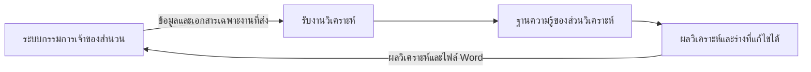

# แบบระบบวิเคราะห์และร่างคำวินิจฉัยเบื้องต้น

วันที่ 9 ตุลาคม 2569

แบบนี้ปรับตามคำยืนยันของผู้ใช้ให้แยกงานชัดเจน ระบบทะเบียนรายชื่อผู้ร้องและการรับผิดชอบสำนวนเป็นงานของกรรมการเจ้าของสำนวน ส่วนระบบที่ออกแบบในเอกสารนี้รับผิดชอบการวิเคราะห์จากข้อมูลที่ได้รับ จัดทำร่างให้แก้ไขได้ และส่งออก Word ฐานข้อมูลกฎหมาย อาวุโส การแต่งตั้ง และตัวอย่างคำวินิจฉัยที่เตรียมไว้เป็นฐานของส่วนวิเคราะห์เท่านั้น

สถานะ 9 ตุลาคม 2569: สร้างแอปในเครื่องตามขอบเขตนี้แล้วที่ `analysis-app/` เปิดด้วย `Start-Analysis.cmd` และใช้งานที่ `http://127.0.0.1:4318` รับข้อมูลเฉพาะงาน ตรวจหลักฐาน แก้ร่าง เก็บฉบับ และส่งออก Word ได้ ฐานเก็บแยกจากทะเบียน ส่วน AI ยังรออนุมัติ API key และยังไม่ตรวจบริการจริง อ่าน `analysis-app/README.md` และ `QA-REPORT.md` สำหรับวิธีใช้กับข้อจำกัด เอกสารนี้ยังเป็นแบบและข้อกำหนดอ้างอิง ไม่ใช่การรับรองว่าทุกรายการพร้อมใช้ใน production หลายผู้ใช้

## เจ้าของงานและขอบเขตสองระบบ

| งานหรือข้อมูล | ระบบกรรมการเจ้าของสำนวน | ระบบวิเคราะห์ |
|---|---|---|
| ทะเบียนรายชื่อผู้ร้อง เลขสำนวน และข้อมูลสำนวนต้นทาง | เป็นผู้ดูแลข้อมูลหลัก | รับเฉพาะข้อมูลที่ส่งมาใช้ในงานวิเคราะห์ |
| กรรมการที่รับผิดชอบ การมอบหมาย เปลี่ยนเจ้าของ และติดตามสำนวน | เป็นผู้ดูแล | ไม่จัดการหรือแก้ไขข้อมูลเหล่านี้ |
| เอกสารต้นสำนวน | เป็นแหล่งต้นทางตามที่ผู้ใช้ส่ง | เก็บสำเนาหรือไฟล์ที่ส่งมา พร้อมรุ่นและที่มา เพื่อรองรับผลวิเคราะห์ |
| ฐานกฎหมาย อาวุโส แต่งตั้ง และตัวอย่างคำวินิจฉัย | ไม่ต้องนำเข้าฐานนี้เพื่อมอบหมายสำนวน | เป็นผู้ดูแลรุ่น แหล่งข้อมูล และสถานะตรวจยืนยัน |
| ผลวิเคราะห์ หลักฐานที่ใช้อ้าง และข้อมูลที่ยังขาด | รับไปประกอบการทำงานเมื่อส่งกลับ | เป็นผู้จัดทำและเก็บประวัติ |
| ร่างเบื้องต้นที่แก้ไขได้และไฟล์ Word | รับผลส่งกลับไปดำเนินงานตามสำนวน | เป็นผู้จัดทำ แก้ไข บันทึกรุ่น และส่งออก |
| ผลพิจารณาทางราชการ เลขเรื่องแดง และการปิดสำนวน | ดำเนินตามกระบวนการของฝ่ายเจ้าของสำนวน | ไม่เปลี่ยนสถานะทางราชการจากการส่งออก Word |

แยกฐานจัดเก็บและสิทธิของระบบวิเคราะห์จากทะเบียนกรรมการ ไม่มีตารางผู้ร้องหลักหรือความสัมพันธ์ฐานข้อมูลที่เขียนกลับ `Case` ของแอปทะเบียน ระบบวิเคราะห์เก็บชื่อผู้ร้องได้เฉพาะในชุดข้อมูลของงานที่ได้รับ เพื่อเทียบบุคคลและประกอบร่าง ชื่อนี้เป็นข้อมูลสำเนาอ้างอิง ไม่กลายเป็นทะเบียนรายชื่อผู้ร้องอีกชุดหนึ่ง

## การส่งงานระหว่างสองส่วน

เริ่มต้นด้วยการกรอกข้อมูลอ้างอิงและอัปโหลดชุดเอกสารเฉพาะงาน ระบบวิเคราะห์ใช้งานได้โดยไม่ต้องเชื่อม API หรืออ่านฐานทะเบียนกรรมการโดยตรง การเชื่อมส่งงานอัตโนมัติเป็นงานภายหลังที่ต้องออกแบบและอนุมัติแยกต่างหาก ไม่เปิดการค้นทั้งทะเบียนโดยปริยาย

| ชุดข้อมูลส่งเข้า | ความหมาย |
|---|---|
| รหัสสำนวนต้นทางและชื่อระบบต้นทาง เมื่อมี | ใช้อ้างกลับ ไม่สร้างหรือเปลี่ยนเลขสำนวนทางราชการ |
| ชื่อเรื่อง ผู้ร้อง คู่กรณี ยศ ตำแหน่ง และข้อมูลที่เกี่ยวข้อง | ข้อมูลเฉพาะงานเพื่อเทียบแหล่งและร่างเอกสาร |
| คำร้อง ประเด็น คำขอ เหตุการณ์ และคำชี้แจง | เนื้อหาที่ต้องวิเคราะห์ พร้อมระบุที่มาและสถานะข้อกล่าวอ้าง |
| ไฟล์ประกอบที่เลือกส่ง | คำร้อง หลักฐาน คำชี้แจง คำสั่ง หรือเอกสารเพิ่มเติม |
| ผู้ส่งและเวลาส่ง เมื่อทราบ | บันทึกที่มาของชุดข้อมูล ไม่ใช้เป็นการมอบหมายกรรมการ |

ระบบสร้าง `analysis_job_id` ของตัวเองสำหรับแยกงาน เก็บ `external_case_ref` เป็นรหัสสำนวนอ้างอิงที่อาจว่างได้ถ้ายังไม่ได้รับมา ไม่ทำ foreign key ไปยังฐานทะเบียน งานหลายรอบที่อ้างสำนวนเดียวกันเก็บเป็นหลายรุ่นได้ โดยไม่สร้างสำนวนใหม่ในทะเบียน

ชุดข้อมูลส่งกลับประกอบด้วยรหัสงานวิเคราะห์ รหัสอ้างอิงต้นทาง รุ่นข้อมูลที่ใช้ ผลวิเคราะห์พร้อมรายการอ้างอิง สิ่งที่ยังขาด และร่าง .docx ที่เลือกส่งออก การส่งกลับเป็นการส่งมอบผลให้เจ้าของสำนวน ไม่เขียนทับทะเบียนหรือร่างทางราชการในระบบอื่นโดยอัตโนมัติ

หากข้อมูลต้นทางเปลี่ยน ให้รับเป็นรุ่นใหม่และแสดงว่างานวิเคราะห์เดิมใช้ข้อมูลรุ่นก่อน การแก้ข้อความเพื่อวิเคราะห์ไม่แก้ไฟล์หรือข้อมูลต้นทาง เมื่อพบความคลาดเคลื่อนให้บันทึกข้อทักท้วงส่งกลับ

## หน้าจอของระบบวิเคราะห์

หน้าแรกเป็นรายการงานวิเคราะห์ มีชื่อเรื่อง รหัสงาน รหัสสำนวนอ้างอิง สถานะการวิเคราะห์ และเวลาปรับปรุงล่าสุด ไม่มีหน้าทะเบียนผู้ร้องหรือหน้ามอบหมายกรรมการ เปิดแต่ละงานแล้วมี 5 แท็บ

| แท็บ | การใช้งาน |
|---|---|
| 1 ข้อมูลที่ใช้วิเคราะห์ | รับหรือกรอกข้อมูลเฉพาะงาน ประเด็น คำขอ และข้อมูลบุคคลอ้างอิง ตรวจสิ่งที่ยังขาด |
| 2 เอกสารประกอบ | แนบเอกสาร ตรวจข้อความที่อ่านได้ แก้ OCR และเก็บหน้าอ้างอิง |
| 3 ผลวิเคราะห์ | เทียบหลักฐาน กฎหมาย การแต่งตั้ง อาวุโส และแสดงข้อมูลที่ขาดหรือขัดกัน |
| 4 ร่างเบื้องต้น | ร่างทีละส่วน รับข้อเสนอ แก้ไขเอง และบันทึกฉบับ |
| 5 ส่งออก | เลือกฉบับร่างที่บันทึกแล้ว ดูตัวอย่าง และดาวน์โหลด Word พร้อมผลประกอบ |

สถานะในส่วนนี้เป็น รับข้อมูลแล้ว กำลังตรวจหลักฐาน พร้อมวิเคราะห์ วิเคราะห์แล้ว ร่างแล้ว และส่งออกแล้ว ไม่ใช้แทนสถานะรับเรื่อง มอบหมายกรรมการ นัดประชุม วินิจฉัยเสร็จ หรือปิดสำนวน

## ฐานข้อมูลของส่วนวิเคราะห์

แบ่งเป็นฐานความรู้กลางที่ผู้ใช้อนุมัติ และพื้นที่ข้อมูลเฉพาะงานวิเคราะห์ ฐานความรู้ประกอบด้วยกฎหมายและหลักเกณฑ์ ข้อมูลการแต่งตั้ง บัญชีอาวุโส ตัวอย่างคำวินิจฉัย และบันทึกแก้ไข/ตรวจยืนยัน บุคคลในบัญชีอาวุโสและแต่งตั้งเป็นข้อมูลอ้างอิงทางการวิเคราะห์ ไม่ใช่ทะเบียนผู้ร้องหรือทะเบียนการมอบหมาย

ใช้ [ชุดปัจจุบัน](C:/APP/data/police-appointments-2569/CURRENT/README-เริ่มตรงนี้.md) และ [SQLite ต้นทาง](C:/APP/data/police-appointments-2569/current-database.sqlite3) ที่เตรียมไว้ เก็บรุ่นและ fingerprint เมื่อรับเข้าและในทุก snapshot การนำเข้าไปยังฐานแอปวิเคราะห์ต้องตรวจ manifest ไม่เปลี่ยนต้นฉบับและไม่ผูกให้ระบบกรรมการต้องใช้ฐานนี้

พื้นที่เฉพาะงานเก็บชุดข้อมูลที่ส่งมา สำเนาเอกสาร ข้อเท็จจริงที่ตรวจ ผลวิเคราะห์ ร่าง และประวัติส่งออก ทุกข้อมูลผูกกับ `analysis_job_id` แยกสิทธิอ่าน แก้ข้อมูล ตรวจหลักฐาน ใช้ AI ส่งออก และจัดการฐานกลาง ภายในระบบวิเคราะห์ ไม่อ้างว่ากรรมการเจ้าของสำนวนเป็นบัญชีผู้ใช้หรือผู้ควบคุมงานวิเคราะห์โดยอัตโนมัติ

### โครงข้อมูลที่เสนอ

ตารางต่อไปนี้เป็นข้อเสนอสำหรับส่วนวิเคราะห์ ยังไม่สร้างตารางหรือ migration ของระบบใด

| ข้อมูล | หน้าที่ |
|---|---|
| AnalysisJob | รหัสงาน ชื่อเรื่อง รหัสสำนวนอ้างอิง และสถานะงานวิเคราะห์ |
| InputSnapshot / AnalysisSubjectSnapshot | ข้อมูลคำร้อง ประเด็น คำขอ และชื่อ/ยศ/ตำแหน่งที่รับมาเฉพาะงาน พร้อมรุ่นและที่มา |
| AnalysisDocument / ExtractionRevision | ไฟล์ต้นฉบับของชุดส่งมา SHA-256 ข้อความแยกหน้า และประวัติแก้ OCR |
| EvidenceFact / AnalysisIssue | ข้อกล่าวอ้างหรือข้อเท็จจริง ประเด็น หลักฐานสนับสนุน ข้อมูลขัดกัน และสถานะการตรวจ |
| SourceBundle / SourceDocument / JobSourceApproval | รุ่นฐานกลาง รายการแหล่งที่อนุญาตในงาน และสถานะ active/superseded/authority/reference_only |
| SeniorityRecord / AppointmentRecord / VacancyEvidence | ข้อมูลเทียบบุคคล ระดับ ประเภทบัญชี ลำดับ จำนวนต้นทาง ตำแหน่งว่างที่ยืนยันได้ และหน้าอ้างอิง |
| AnalysisRun / AnalysisFinding | snapshot ชุดแหล่งและข้อมูล ผลวิเคราะห์ การคำนวณ การอ้างอิง และข้อจำกัด |
| DraftRevision / DraftSectionRevision | ข้อเสนอและข้อความที่ผู้ใช้แก้ บันทึกรายส่วน และประวัติฉบับ |
| ExportRecord | ฉบับที่เลือกส่งออก รุ่นแม่แบบ hash ไฟล์ เวลา ผู้ส่งออก และรหัสงานอ้างอิง |

ไม่มีการเพิ่มหน้าทะเบียนผู้ร้อง ตารางมอบหมายกรรมการ หรือการแก้สถานะคดีในขอบเขตนี้ ไม่มีการนำฐาน `Case` ทั้งชุดมาคัดลอก ทุก API และการส่งออกตรวจว่า document, finding และ draft เป็นของงานวิเคราะห์เดียวกัน

## การอ่านเอกสารและยืนยันข้อมูล

รองรับ PDF, DOCX, XLSX และภาพ JPG/PNG ตรวจชนิดไฟล์จริง เก็บต้นฉบับแยกจากข้อความที่ถอดได้ และไม่เรียกใช้ macro PDF สแกนและภาพต้องมี OCR ภาษาไทยกับภาพหน้าอ้างอิง ข้อมูลอ่านไม่ชัดแสดงให้ผู้ใช้ตรวจโดยไม่เติมชื่อ เลขข้อ หรือวันที่เอง

ขั้นตอนคือ แนบแล้ว → กำลังอ่าน → รอตรวจข้อความ → ยืนยันแล้ว หรือ อ่านไม่สำเร็จ ข้อความในไฟล์เป็นเนื้อหาประกอบ ไม่ใช่คำสั่งให้ AI เปลี่ยนกฎ เอกสารที่ระบุงานไม่ได้อยู่ในพื้นที่รอตรวจและยังไม่ใช้สร้างร่าง

ข้อมูลที่กรอกหรือรับมาจากระบบกรรมการมีที่มา แต่ไม่ถือว่าเป็นข้อเท็จจริงที่พิสูจน์แล้วทั้งหมด แยกข้อกล่าวอ้าง คำชี้แจง และข้อเท็จจริงที่ตรวจพร้อมหลักฐาน การยืนยันเป็นการตรวจของผู้ใช้ ไม่ใช่ AI เปลี่ยนสถานะเอง เมื่อแก้ OCR ต้องเก็บข้อความก่อนแก้ หลังแก้ หน้าเอกสาร ผู้แก้ และเวลา

## การวิเคราะห์และการแยกแหล่ง

Strict Source Isolation ใช้เฉพาะฐานกลางที่อนุมัติในงานนั้นกับเอกสารของ `analysis_job_id` เดียวกัน ไม่ค้นงานอื่น แชตอื่น เว็บ หรือแหล่งรุ่นเก่าโดยปริยาย ตัวอย่างคำวินิจฉัยใช้ประกอบโครงสร้างและภาษา ไม่ย้ายชื่อหรือข้อเท็จจริงมาเป็นเรื่องใหม่

ดัชนีใช้หาเนื้อหา แล้วตรวจ canonical ข้อแก้ไข และหน้าต้นฉบับเพื่อยืนยัน กฎหมายที่ถอดข้อความผิดต้องตรวจย่อหน้าที่ใช้จริง ไม่ยืนยันทั้งไฟล์จากสถานะ official หรือ internal เพียงอย่างเดียว

ขั้นวิเคราะห์แยกประเด็น ทำตารางข้อเท็จจริงกับหลักฐาน ตรวจตัวบุคคลด้วยชื่อร่วมกับยศ ตำแหน่ง ระดับและประเภทบัญชี ค้นหลักเกณฑ์ที่ตรวจแล้ว แล้วสร้างผลรายประเด็นพร้อมข้อจำกัด ชื่อเหมือนกันหรือใกล้เคียงต้องให้ผู้ใช้เลือกก่อนเทียบ

ผลวิเคราะห์แยกข้อเท็จจริง ผลคำนวณ และเหตุผลทางกฎหมาย พร้อมหน้า/ย่อหน้า/ชีต/เซลล์ที่อ้าง ข้อมูลไม่พอให้แสดงสิ่งที่ขาดและหยุดข้อสรุปที่พึ่งข้อมูลนั้น ส่วนที่มีแหล่งเพียงพอทำต่อได้ การวิเคราะห์ไม่กำหนดผลคดีทางราชการหรือคะแนนโอกาสชนะ

### ช่องว่างของฐานปัจจุบัน

ผลตรวจเมื่อออกแบบรุ่นก่อนพบ manifest 27 ไฟล์และ hash SQLite ตรงกัน ฐานมีแต่งตั้ง 281 ราย ข้อความอาวุโส 63 หน้า ผลจับคู่อาวุโสที่ตรวจภาพ 181 ราย และจำนวนของ 13 ประเภทที่มีผู้ได้รับเลื่อนในชุดตรวจ ต้องตรวจ manifest ซ้ำเมื่อรับเข้าระบบจริง

181 รายเป็นผู้ได้รับเลื่อนในชุด 184 ราย ยังไม่ใช่การถอดรายชื่อครบทั้งบัญชี อีก 3 รายมีระดับต้นทางอยู่นอกขอบเขต PDF เมื่อวิเคราะห์บุคคลที่ยังไม่มีรายการยืนยัน ต้องตรวจภาพบัญชีปัจจุบันและเพิ่มข้อมูลอ้างอิงบุคคลในฐานวิเคราะห์ก่อน การไม่พบชื่อใน 181 รายไม่พิสูจน์ว่าไม่มีชื่อในบัญชีหรือไม่เหมาะสม

อาวุโส 2569 ใช้ `seniority_2569_round4_2026-08-07_CURRENT.pdf` เท่านั้น ห้ามนำแหล่งรุ่นเก่ามาเติม รายการแต่งตั้งเดิมยังเป็น inherited แยกจากสถานะตรวจภาพอาวุโส จำนวนผู้เหมาะสมใช้ตามนิยามฐานวิเคราะห์ของผู้ใช้ ไม่ขยายเป็นข้อกฎหมาย

ตำแหน่งว่างจริงยังไม่มีแหล่งยืนยัน จึงไม่คำนวณโควตาหรือใช้จำนวนผู้ได้รับแต่งตั้งแทน เมื่อมีแหล่งตัวเลขและหลักเกณฑ์ที่ใช้กับกรณีนั้นยืนยันครบ จึงคำนวณพร้อมแสดงแหล่งและสูตร

## การร่างและแก้ไข

เริ่มร่างจาก snapshot ที่ผู้ใช้ตรวจแล้ว ดำเนินทีละส่วนแม้เริ่มจากปุ่มเดียว ไม่สร้างคำวินิจฉัยทั้งหมดด้วย AI ครั้งเดียว ส่วนร่างประกอบด้วยข้อมูลเรื่องและคู่กรณี คำร้อง/คำขอ คำชี้แจง ข้อเท็จจริง ประเด็น กฎหมาย/หลักเกณฑ์ การวิเคราะห์ และข้อเสนอผลพิจารณาเบื้องต้น

กฎหมายเกี่ยวกับเขตอำนาจ กำหนดเวลา หรือสิทธิภายหลังคำวินิจฉัย ใส่เมื่อแหล่งที่ยืนยันครบ ไม่เติมชื่อผู้ลงนาม วันลงนาม หรือเลขเรื่องแดงเอง ใช้ “พิเคราะห์แล้วเห็นว่า” สำหรับกฎหมายและหลักเกณฑ์ และ “พิจารณาแล้วเห็นว่า” สำหรับข้อเท็จจริง การปรับบท การเปรียบเทียบและดุลยพินิจ

ก่อนเรียก AI ประกอบเฉพาะข้อมูลของงานและรายการแหล่งที่อนุญาต ส่งกลับข้อความพร้อมรหัสแหล่ง/ย่อหน้า ตรวจว่าอ้างอิงมีอยู่และรองรับข้อความนั้น บริการ AI ไม่มีเครื่องมือค้นทะเบียนกรรมการ เว็บ หรือคลังสำนวนอื่น

แสดงข้อเสนอ AI แยกจากข้อความที่ผู้ใช้บันทึก มีการรับข้อความ แทรกบางส่วน แก้เอง และดูผลต่าง การร่างใหม่ไม่ทับข้อความมนุษย์อัตโนมัติ เมื่อข้อมูลต้นทางหรือฐานกลางเปลี่ยน แจ้งว่าร่างใช้รุ่นก่อนแล้วสร้างรอบใหม่ตามที่ผู้ใช้เลือก

## การส่งออกและส่งกลับ

ส่งออก `.docx` จาก `draft_revision_id` ที่ผู้ใช้เลือกและบันทึก ใช้แม่แบบที่รับรอง แสดงตัวอย่างก่อนดาวน์โหลด ข้อความต้องตรงกับฉบับที่เลือก มีสถานะร่างเบื้องต้น รายการอ้างอิง และข้อมูลที่ยังรอตรวจ ไม่เลือกฉบับแรกหรือฉบับทางราชการของทะเบียนจากฐานอื่น

บันทึก `analysis_job_id`, `external_case_ref`, รุ่นข้อมูล รุ่นแม่แบบ เวลา ผู้ส่งออก และ hash ของไฟล์ ตรวจภาพ render ทุกหน้าให้ภาษาไทย ตาราง และเลขหน้าอ่านได้ ผู้ใช้แก้ Word ต่อได้ แต่การแก้ใน Word ไม่กลับเข้าระบบวิเคราะห์อัตโนมัติในแบบเริ่มต้น

ผู้ใช้ส่งผลวิเคราะห์และ Word กลับกรรมการเจ้าของสำนวนได้ตามช่องทางของตน ไม่เปลี่ยนทะเบียน เลขสำนวน การมอบหมาย หรือสถานะทางราชการ การส่งออกเป็นจบงานร่างที่เลือกในส่วนวิเคราะห์

## ส่วนที่นำโค้ดเดิมมาประกอบได้

ใช้แอปเดิมเป็นแหล่งโค้ดอ้างอิงเฉพาะงานแนบ/อ่านข้อความ ค้นแหล่ง แก้ไขร่าง และส่งออก โดยแยกบริการและฐานเก็บของส่วนวิเคราะห์ ไม่ต่อการทำงานให้ต้องอ่านตาราง Case หรือการมอบหมายของระบบกรรมการ

โค้ดเดิมที่ตรวจมีการอัปโหลดไฟล์ การค้น legal chunks การร่างรายส่วน DraftEditor และ exporter Word ส่วนเหล่านี้ต้องปรับให้ใช้รหัสงานวิเคราะห์และ snapshot ของตัวเอง ยังไม่ได้ยืนยันว่าถอดออกใช้ได้ทันที ไม่รวมหน้าทะเบียน CaseTable การมอบหมายกรรมการ การติดตามประชุม หรือการปิดสำนวนในแผนนี้

ฐาน SQLite ที่เตรียมเป็นต้นทางสำหรับฐานความรู้ของส่วนวิเคราะห์ หากนำเข้า PostgreSQL หรือฐานแอปอื่นต้องมีรุ่นและขั้นตรวจชัดเจน ไม่ใช้ฐานทะเบียนกรรมการเป็นฐานวิเคราะห์ และไม่เก็บข้อมูลเดียวกันให้สองระบบแก้แข่งกัน

## ลำดับพัฒนาและเกณฑ์รับงาน

| ระยะ | ผลงานส่วนวิเคราะห์ | หลักฐานว่าผ่าน |
|---|---|---|
| 1 รับงานและแยกข้อมูล | รับข้อมูลเฉพาะงานและรายการงานวิเคราะห์ | สร้างงานจากไฟล์/ข้อมูลที่ส่งมาได้โดยไม่เชื่อมฐานทะเบียน ไม่สร้างหรือแก้สำนวนในระบบกรรมการ |
| 2 เอกสารและฐานความรู้ | อ่าน ตรวจข้อความ ตรวจรุ่นฐาน และข้อมูลเทียบบุคคล | เปิดต้นฉบับและหน้าอ้างอิงได้ อ่านไม่สำเร็จแจ้งชัด บุคคลที่ยังไม่มีข้อมูลยืนยันตรวจจาก PDF ปัจจุบันได้ |
| 3 วิเคราะห์ | ผลรายประเด็นพร้อมแหล่ง ข้อจำกัด และข้อมูลขาด | ไม่ปนงาน ไม่ fallback แหล่งเก่า และไม่คำนวณโควตาหากขาดแหล่งตำแหน่งว่าง |
| 4 ร่างและแก้ไข | ร่างรายส่วน บันทึกรุ่น และเทียบข้อความ | รับหรือแก้ข้อเสนอได้ งานมนุษย์ไม่ถูกทับและต้นทางเปลี่ยนแล้วแจ้งผล |
| 5 Word และส่งมอบ | ส่งออกฉบับที่เลือกกับผลประกอบ | Word เปิดได้ ข้อความ/อ้างอิงตรงรุ่น และไม่มีการเขียนกลับทะเบียนหรือสถานะกรรมการ |

ก่อนรับแอปต้องทดลองสองงานที่ประเด็นคล้ายกันแล้วยืนยันว่างานหนึ่งดึงเอกสารอีกงานไม่ได้ ทดลองข้อมูลต้นทางสองรุ่น ชื่อบุคคลซ้ำ แหล่ง superseded หลักฐานไม่พอ และการส่งออกหลังแก้ร่าง ทดสอบด้วยว่าเมื่อระบบทะเบียนไม่พร้อมใช้งาน ระบบวิเคราะห์ยังรับชุดข้อมูลที่ผู้ใช้ส่งและทำงานต่อได้

การเชื่อม AI เป็นขั้นพัฒนาภายหลัง แบบนี้ยังไม่ต้องตั้งค่า API key การส่งมอบครั้งนี้แก้เฉพาะแบบระบบและบันทึกโครงการ ฐานข้อมูลที่เตรียมไว้และโค้ดระบบกรรมการคงเดิม
